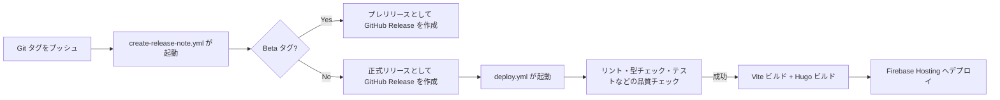

# リリースフロー

## 概要

Bicpema のリリースは **Git タグ** をトリガーとして自動化されています。



## バージョンタグの種類

| タグパターン   | 用途                               |
| -------------- | ---------------------------------- |
| `v*.*.*`       | 正式リリース（例: `v1.2.0`）       |
| `v*.*.*-Beta*` | プレリリース（例: `v1.2.0-Beta1`） |

タグ形式の詳細は [バージョニング規約](./versioning.md) を参照してください。

## リリース手順

### 1. `main` ブランチを最新化する

```bash
git checkout main
git pull origin main
```

### 2. タグを作成してプッシュする

```bash
# 正式リリース
git tag v1.2.0
git push origin v1.2.0

# プレリリース
git tag v1.2.0-Beta1
git push origin v1.2.0-Beta1
```

### 3. GitHub Actions の完了を確認する

[Actions タブ](https://github.com/Bicpema/bicpema/actions) で以下のワークフローが正常終了したことを確認します。

1. `create-release-note.yml` — GitHub Release の作成
2. `deploy.yml`（正式リリースのみ） — 品質チェック（`verify` ジョブ）の後、Firebase Hosting へのデプロイ

### 4. デプロイを確認する

<https://bicpema.com/> にアクセスして、変更が反映されていることを確認します。

## リリースノートの自動生成

`.github/release.yml` に定義されたラベルとカテゴリに基づいて、PR・コミット履歴からリリースノートが自動生成されます。

| カテゴリ                          | 対象ラベル                                       |
| --------------------------------- | ------------------------------------------------ |
| 🆕 シミュレーションの新規作成     | `シミュレーションの新規作成`                     |
| 🔧 シミュレーションのメンテナンス | `シミュレーションのメンテナンス`                 |
| 📝 記事の新規作成                 | `記事の新規作成`                                 |
| ✏️ 記事のメンテナンス             | `記事のメンテナンス`                             |
| 📦 依存関係の更新                 | `依存関係`, `npm`                                |
| 🛠️ 開発環境改善                   | `開発環境改善`, `github actions`, `Agent Skills` |
| 🎨 Hugo テンプレート              | `Hugo`                                           |

!!! tip
`not triaged` ラベルと `リリース` ラベルはリリースノートから除外されます。

## 手動デプロイ

緊急時など、タグを使わずに手動でデプロイしたい場合は GitHub Actions の `deploy.yml` を手動実行できます。

1. [Actions タブ](https://github.com/Bicpema/bicpema/actions/workflows/deploy.yml) を開く
2. 「Run workflow」ボタンをクリックする
3. ブランチ（通常は `main`）を選択して実行する

## デプロイワークフローの保護

`deploy.yml` には、本番環境を守るための以下の設定が入っています。

- **品質チェック**: `verify` ジョブでリント・型チェック・ユニットテスト・テンプレート準拠チェック・記事リンク整合性チェックを実行し、すべて成功した場合のみ `deploy` ジョブが実行されます。失敗した場合は本番にデプロイされません。
- **最小権限**: `permissions` で `contents: read` のみを許可しています（`check-article-links.yml` も同様）。
- **同時実行制御**: `concurrency`（グループ `deploy-production`、`cancel-in-progress: false`）により、デプロイが同時に実行されず、実行中のデプロイは中断されません。
- **Environment**: `deploy` ジョブは `environment: production` で実行されます。Firebase のサービスアカウント（`FIREBASE_SERVICE_ACCOUNT_BICPEMA`）は、リポジトリの Settings → Environments → `production` のシークレットに登録します。必要に応じて同画面で承認者（Required reviewers）も設定できます。
