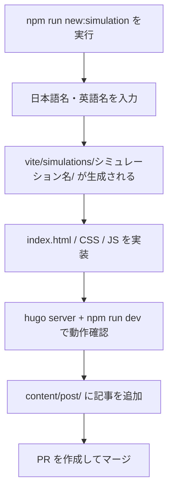

# シミュレーション実装方法

## 実装の流れ



## 関連ページ

- [ファイル構成（リポジトリ全体）](./repository-files.md) — リポジトリ全体のディレクトリ構成
- [ファイル構成（シミュレーション）](./simulation-files.md) — `vite/` ディレクトリの構成

## 雛形の生成

リポジトリルートで以下を実行します。

```bash
npm run new:simulation
```

対話形式で以下を入力します。

| 項目                     | 例               |
| ------------------------ | ---------------- |
| 日本語名                 | `ドップラー効果` |
| 英語名（ハイフン区切り） | `doppler`        |

実行後、`vite/simulations/doppler/` に基本テンプレートが生成されます。

生成された `ts/index.ts` には、共通コンポーネント（`vite/ts/components/`）の使用例が含まれており、ビルドするとサンプルの矢印・点線が表示されます。

- `Arrow`（`SimComponent`）: `update()` / `draw(p)` で更新・描画する、状態を持つ矢印
- `drawDashedLine` / `drawArrowWithLabel`: 状態を持たない描画関数

実装を始める際は、`index.ts` 内の「共通コンポーネントの使用例」ブロックと `demoArrow` を削除し、必要な部品に置き換えてください。

## 実装パターン

シミュレーションには **2 つの実装パターン** がありますが、[Issue #512](https://github.com/Bicpema/bicpema/issues/512) により **パターン A（p5 インスタンスモード）に統一する方針** が決定しています。新規シミュレーションは必ずパターン A で実装してください。

パターン B（グローバルモード）はp5.jsのAPIを`window`のグローバル関数として直接定義するため、TypeScript化（[#424](https://github.com/Bicpema/bicpema/issues/424)）で導入した型チェック（`checkJs`/`.ts`）との相性が悪く、新規実装では使用しません。既存のパターン B 実装は、[#511](https://github.com/Bicpema/bicpema/issues/511) の段階移行の中でパターン A へ書き換えたうえで`.ts`化します。

### パターン A — ES モジュール + p5 インスタンスモード（標準）

採用しているシミュレーションの標準構成です。新規シミュレーションは`npm run new:simulation`が生成するひな形（`vite/_templates/simulation/`配下）がこの構成に沿っているため、そのまま実装を進めてください。

```txt
vite/simulations/{name}/
├── index.html
├── css/
│   └── style.css
└── ts/
    ├── index.ts               # エントリーポイント（p5 スケッチの定義）
    ├── init.ts                # 初期化処理
    ├── state.ts               # 共有状態の管理
    ├── logic.ts               # シミュレーションのロジック
    ├── element-function.ts    # UI コントロールのイベントハンドラー
    ├── class.ts               # クラス定義
    └── graph.ts               # グラフ描画処理
```

キャンバスサイズ制御（`BicpemaCanvasController`）やローディングスピナー制御は`vite/ts/`配下の共通モジュールとして提供されており、各シミュレーションからimportして利用します。

`index.ts` の基本構造:

```ts
import p5 from "p5";
import "../../../css/tailwind.css";
import { BicpemaCanvasController } from "../../../ts/bicpema-canvas-controller.js";
import { hideLoadingSpinner } from "../../../ts/bicpema-loading-spinner.js";
import {
    settingInit,
    elementSelectInit,
    elementPositionInit,
    valueInit
} from "./init.js";

const sketch = (p: p5) => {
    const canvasController = new BicpemaCanvasController();
    let isFirstDraw = true;

    p.setup = () => {
        canvasController.fullScreen(p);
        settingInit(p);
        elementSelectInit(p);
        elementPositionInit(p);
        valueInit(p);
    };

    p.draw = () => {
        // 毎フレームの描画処理

        if (isFirstDraw) {
            isFirstDraw = false;
            hideLoadingSpinner();
        }
    };

    p.windowResized = () => {
        canvasController.resizeScreen(p);
        elementPositionInit(p);
    };
};

new p5(sketch);
```

`BicpemaCanvasController`はオプションオブジェクトを1つ受け取ります。すべて省略可能で、既定値は標準の2D・全画面・16:9固定表示になるよう設定されています。

| オプション          | 型                       | 既定値     | 説明                                                                                                  |
| ------------------- | ------------------------ | ---------- | ----------------------------------------------------------------------------------------------------- |
| `fixedAspectRatio`  | `boolean`                | `true`     | `true`の場合、16:9比率を維持したままキャンバスを配置する。`false`の場合は利用可能領域いっぱいに広がる |
| `is3D`              | `boolean`                | `false`    | `true`の場合、WEBGLモードの3Dキャンバスを生成する                                                     |
| `widthRatio`        | `number`（`0.0`〜`1.0`） | `1.0`      | 算出した幅に対して掛け合わせる比率                                                                    |
| `heightRatio`       | `number`（`0.0`〜`1.0`） | `1.0`      | 算出した高さに対して掛け合わせる比率                                                                  |
| `panelSelector`     | `string \| null`         | `null`     | 指定した場合、そのDOM要素のサイズをウィンドウサイズの代わりに利用可能領域として使用する               |
| `bottomBarSelector` | `string \| null`         | `null`     | 指定した場合、そのDOM要素の高さ（+4px）を利用可能な高さから差し引く                                   |
| `heightMode`        | `"aspect" \| "half"`     | `"aspect"` | `"half"`の場合、アスペクト比の計算を行わず、利用可能な高さの半分をそのままキャンバスの高さにする      |

既定値以外を指定する場合は、必要なオプションのみを渡します。

```ts
// 3Dシミュレーションで、パネル要素を利用可能領域とする例
const canvasController = new BicpemaCanvasController({
    is3D: true,
    panelSelector: "#p5Canvas"
});
```

### 描画・UI部品のコンポーネント化

複数のシミュレーションで重複しがちな描画部品は、`vite/ts/components/` 配下に共通コンポーネントとして切り出します（[Issue #818](https://github.com/Bicpema/bicpema/issues/818)）。

- **共通インターフェース**: `vite/ts/components/sim-component.ts` の `SimComponent`（`update()` で状態更新、`draw(p)` で描画、`reset()` で初期状態へ戻す、`dispose()` でリソース解放）。一時停止中は `update()` を呼ばず `draw(p)` のみ呼ぶことで、[パフォーマンス方針](#パフォーマンス方針)の描画抑制に沿えます。
- **部品のまとめ管理**: `vite/ts/components/component-group.ts` の `ComponentGroup` が複数の `SimComponent` を束ね、`update()` / `draw(p)` / `reset()` / `dispose()` を一括で呼びます。コンストラクターに「一時停止中か」を返す関数を渡すと、一時停止中は `update()` をスキップして `draw(p)` のみ実行します（`new ComponentGroup(() => !isPlaying)` のように使います）。
- **設定値の反映**: 設定パネルの値は、呼び出し側（`onChange` 等のハンドラー）が部品のプロパティへ直接代入します（例: `arrow.color = ...`）。イベントバスやリアクティブ化は行いません。
- **配置場所**: 1ファイル1コンポーネント（ケバブケース）で `vite/ts/components/` に置きます。シミュレーション固有の部品は従来どおり各シミュレーションの `ts/class.ts` に置きます。
- **関数とクラスの使い分け**: 状態を持たない描画は関数（例: `drawArrow`）、状態を持ち毎フレーム更新するものは `SimComponent` を実装するクラス（例: `Arrow`）で提供します。
- **提供済みの部品**: 矢印（`arrow.ts`）・点線（`dashed-line.ts`）・座標系（`coordinate-system.ts`、p5非依存の物理座標とピクセルの変換）。使用例は`npm run new:simulation`が生成するひな形の`ts/index.ts`にあります。再生・停止ボタンのバインディングは従来どおり `vite/ts/bicpema-controls-controller.ts` が担います。
- **既存シミュレーションの移行**: 一括移行はせず、修正するタイミングで段階的に移行します。移行済み: `force-decomposition` / `slope-force-decomposition` / `force-composition` / `archimedes-principle` / `three-force-equilibrium` / `velocity-composition` / `tate-yoko-wave`（矢印）。
- **Storybook**: UI部品の確認用に導入しています（`@storybook/html-vite`）。`npm run storybook` で起動し（`http://localhost:6006`）、`npm run build:storybook` で静的ビルドします。設定は `.storybook/`、storiesはシミュレーションのビルド対象（`vite/`）に混ざらないよう、リポジトリ直下の `stories/` に `*.stories.js` として置きます。
    - `.storybook/preview.js` で `vite/css/tailwind.css` を読み込み、本番と同じ見た目で確認できます。
    - `.storybook/main.js` の `viteFinal` で、Viteのroot（`./vite`）をリポジトリ直下に戻し、Tailwindのプラグインを追加しています。
    - storiesから `?bicpema` 付きでimportしたHTML（例: `import html from "./settings-modal.html?bicpema"`）は、`<bicpema-*>` タグがシミュレーションのビルドと同じ処理で展開されます。
    - 現在のstoriesは再生・リセットボタン、設定ボタン・設定モーダル、矢印（`Arrow`）です。p5を使うstoryは `stories/p5-decorator.js` の `createP5Story()` で作成してください。storyの切り替え（要素の取り外し）時に `p.remove()` で後始末されます。
    - CIは `.github/workflows/storybook.yml` でパスフィルター付きのビルド検査を行います。

#### 重複している部品の候補一覧

`vite/simulations/`（45件）を調査した、重複部品の候補です（[Issue #819](https://github.com/Bicpema/bicpema/issues/819)、2026-10-17時点）。切り出しは、この一覧を元に後続Issueで優先度の高いものから進めます。一覧は切り出しや移行が進むたびに更新してください。

| 部品                         | 重複の状況                                                                                                                                                                                                                                                                    | 切り出し先（案）                                                                          | 状態                                                                                                                                                                                       |
| ---------------------------- | ----------------------------------------------------------------------------------------------------------------------------------------------------------------------------------------------------------------------------------------------------------------------------- | ----------------------------------------------------------------------------------------- | ------------------------------------------------------------------------------------------------------------------------------------------------------------------------------------------ |
| 矢印                         | `drawArrow`を独自定義: `archimedes-principle` / `three-force-equilibrium` / `velocity-composition` / `force-composition` / `tate-yoko-wave` / `slope-force-decomposition` / `force-decomposition`                                                                             | `components/arrow.ts`                                                                     | 提供済み。`force-decomposition`・`slope-force-decomposition`・`force-composition`・`archimedes-principle`・`three-force-equilibrium`・`velocity-composition`・`tate-yoko-wave`は移行済み   |
| 矢印（用途別の派生）         | `drawArrowWithLabel`（`velocity-composition` / `force-composition`）、`drawForceArrow`（`cart-work-ruler` / `force-and-acceleration`）、`drawFlowArrow`（`magnetic-field-straight`）、`arrow`（`normal-force`）など                                                           | `components/arrow.ts`にラベル付きの描画を追加し、派生は共通の矢印を呼ぶ形にする           | `drawArrowWithLabel`を提供済み。`force-composition`は移行済み。他は未着手                                                                                                                  |
| グラフ（Chart.js）           | `ts/graph.ts`を持つ: `cellophane` / `cellophane-color-2` / `free-fall` / `slope-cart-motion` / `train-acceleration` / `uniformly-accelerated-linear-motion` / `vertical-throw-down`。Chart.js利用は他にも`spring` / `uniform-linear-motion` / `cellophane-color-2d-animation` | `components/`配下にChart.jsのグラフを生成・更新する部品                                   | 未着手（等加速度運動系の`graph.ts`が近い構造のため、先に差分を確認する）                                                                                                                   |
| グラフ（p5描画）             | `drawGraph`を独自定義: `cellophane-color-2` / `cellophane-color-2d-animation` / `elastic-force` / `conservation-of-heat-and-specific-heat` / `visualization-of-heat-transfer`                                                                                                 | 上記Chart.js版と統合できるか、軸・目盛りの描画を別部品にするかを後続Issueで判断する       | 未着手                                                                                                                                                                                     |
| 座標軸・グリッド             | `drawGrid`: `wave-reflection` / `standing-wave` / `force-composition` / `oscilloscope` / `force-decomposition`。軸: `drawAxes`（`half-life` / `force-decomposition`）、`drawAxis`（`tate-yoko-wave`）                                                                         | `components/coordinate-system.ts`（座標変換）→ `components/grid.ts`・`components/axes.ts` | `CoordinateSystem`（原点・スケール・Y軸反転・原点基準のグリッド値）を提供済み。`grid.ts`・`axes.ts`は`CoordinateSystem`を受け取る形で後続Issueで切り出す。各シミュレーションの移行は未着手 |
| 点線                         | `drawDashed`: `force-decomposition` / `slope-force-decomposition`（同一実装）。同様の処理: `force-composition` / `lens` / `normal-force`                                                                                                                                      | `components/dashed-line.ts`                                                               | 提供済み。`force-decomposition`・`slope-force-decomposition`・`force-composition`は移行済み                                                                                                |
| 再生・停止・リセットボタン   | 25件が`bindToggleControls` / `bindStartStopControls`を利用済み。ボタンを持つが未利用: `archimedes-principle` / `elastic-force` / `first-law-of-thermodynamics` / `force-and-acceleration` / `three-force-equilibrium`                                                         | 既存の`bicpema-controls-controller.ts`を継続（クラス化は不要）                            | 5件のみ未移行。修正のタイミングで移行する                                                                                                                                                  |
| ボタンのマークアップ         | 再生・リセットボタンのHTML（Tailwindクラス）が各`index.html`にコピーされている                                                                                                                                                                                                | `<bicpema-*>`タグ（`vite/_build/bicpemaComponents.js`）として共通化する案                 | 未着手。切り出す場合はStorybookで見た目を確認する                                                                                                                                          |
| 初期化・イベントハンドラー群 | `drawSimulation`（30件）、`elCreate`（29件）、`initValue`（27件）、`settingInit`（15件）、`onReset`（13件）、`onPlayPause`（11件）などが同名で各シミュレーションに存在する                                                                                                    | 中身はシミュレーション固有のため、共通化の対象外（ひな形の構成で揃っている）              | 対象外                                                                                                                                                                                     |

#### 重複定義の検査

`npm run check:duplicate-components`（CIの`check-duplicate-components.yml`でも実行）が、`vite/simulations/` 内で `drawArrow` / `drawArrowWithLabel` / `drawDashed` / `drawDashedLine` を独自に定義していないかを検査します。未移行の既存分は `scripts/duplicate-components-allowlist.json` に `シミュレーション名:関数名` 形式で登録されています。新しい重複はCIで失敗し、移行して解消済みなのに許可リストへ残っているエントリも失敗するため、移行時は許可リストから削除してください。検査対象の関数名を増やす場合は `scripts/_lib/checkDuplicateComponents.js` の `COMPONENT_FUNCTION_NAMES` に追加します。

優先度は、重複数と実装の同一性から、矢印の派生 → 点線 → 座標軸・グリッド → グラフの順を推奨します。

### パターン B — グローバルモード（旧実装・移行対象）

古いシミュレーションで採用していた構成です。新規作成では使用せず、既存実装は順次パターン A へ移行します。

```txt
vite/simulations/{name}/
├── index.html
├── style.css
└── sketch.js    # p5 グローバルモードのスケッチ
```

## 実装上の注意

- スクロールが発生しないよう、`html, body { overflow: hidden; height: 100%; }` を設定する
- ナビバー・ローディングスピナー・設定ボタン・設定モーダルの外枠は、マークアップを手書きせず[共通UIコンポーネント](#共通uiコンポーネント)の `<bicpema-*>` タグで記述する
- 設定モーダル・操作ボタン・フォーム部品などシミュレーション間で共通のUIパーツは、ユーティリティクラスを個別に並べる前に `vite/css/tailwind.css` の `@layer components`（`.modal-panel` / `.btn-settings-modal-open` / `.form-control` 等）に既存のコンポーネントクラスがないか確認し、再利用する
- 再生・停止ボタンは左下に配置する
- 設定表示ボタンは右上に配置する
- 重いファイル（フォント、画像等）は [Firebase Storage](https://console.firebase.google.com/project/bicpema/storage) にアップロードし、URL で参照する
- 既存シミュレーションのフォルダー名（URL）を変更する場合は、`firebase.json` に旧URLからのリダイレクトを必ず追加する（[掲載URLの維持とリダイレクト](../development-flow.md#掲載urlの維持とリダイレクト)）
- フォントは `setup()` 内で `loadFont()` を使って非同期ロードし、Firebase Storage が到達不能でもスケッチ起動をブロックしないようにする
- `.ts` ファイルのドキュメントコメントは [TSDoc](https://tsdoc.org/) 記法で書く。`npm run lint` の `tsdoc/syntax` ルールで検査される
    - 型はTypeScriptの型注釈で表すため、`@param {number} x` のような `{型}` は書かず、`@param x - 説明` の形式にする
    - 戻り値は `@returns 説明` と書く（`{型}` は書かない）。`@type` / `@constructor` などJSDoc固有のタグは使わない
    - オブジェクト引数のプロパティは `@param params.t` とせず、親の `@param` の説明に ``- `t`: 説明`` の箇条書きで記載する
    - 省略可能な引数の既定値は `[fps=60]` とせず、説明に「（省略時: 60）」と記載する
    - 本文中の `@` `<` `>` `{` `}` はTSDocの構文と解釈されるため、`` `@types/p5` `` のようにコードスパンで囲む
- `.ts` ファイルでは、以下の宣言にドキュメントコメント（`/** */`）を必ず書く。`npm run lint` の `jsdoc-js/require-jsdoc` ルール（`eslint-plugin-jsdoc` の `require-jsdoc`）で検査される
    - 関数: 関数宣言（`function f() {}`）と、変数・プロパティに代入するアロー関数・関数式（`const sketch = (p: p5) => {}`、`p.setup = () => {}`、`{ onReset: () => {} }`、関数内のローカルな補助関数など）
    - メソッド: クラスのメソッド（`constructor`・getter・setter、クラスのプロパティに代入したアロー関数を含む）と、interface・型定義のメソッドシグネチャ（`option(value: string): unknown;`）
    - クラス宣言
    - `export` の有無は問わない。他の関数の引数として直接渡すコールバック（`arr.map((x) => x * 2)`、`addEventListener("click", () => {})` など）は対象外

## 共通UIコンポーネント

シミュレーション間で共通のUIパーツは、`index.html` に `<bicpema-*>` タグで記述します。タグはビルド時に Vite プラグイン（`vite/_build/bicpemaComponents.js`）が共通のマークアップへ展開するため、DOM構造やスタイルを変更する場合は同ファイルを修正するだけで全シミュレーションに反映されます。

| タグ                                                  | 展開後                                                                                        | 属性（省略可）                                                                                                          |
| ----------------------------------------------------- | --------------------------------------------------------------------------------------------- | ----------------------------------------------------------------------------------------------------------------------- |
| `<bicpema-nav-bar></bicpema-nav-bar>`                 | ページ上部のナビバー（`#navBar`）                                                             | `title`: 表示するタイトル（省略時は `<title>` の内容）                                                                  |
| `<bicpema-loading-spinner></bicpema-loading-spinner>` | ローディングスピナー（`#loadingSpinner`）                                                     | なし                                                                                                                    |
| `<bicpema-settings-button></bicpema-settings-button>` | 設定モーダルを開くボタン（`.settings-modal-open`）                                            | `id`: ボタンのid、`class`: ラッパーの配置クラス（省略時は右上）                                                         |
| `<bicpema-settings-modal>…</bicpema-settings-modal>`  | 設定モーダルの外枠（見出し・閉じるボタン）。タグの中身を設定項目として差し込む                | `id`（既定: `simulationSettingModal`）、`title`（既定: `シミュレーションの設定`）、`variant`、`panel-class`（下記参照） |
| `<bicpema-icon name="camera"></bicpema-icon>`         | [Bootstrap Icons](https://icons.getbootstrap.com/) のSVGアイコン（`aria-hidden="true"` 付き） | `name`: アイコン名（必須）、`size`: 幅・高さのpx（既定: `16`）、`class`: 追加するクラス                                 |

- 閉じタグは省略できません。未知のタグ名や展開できないタグがあるとビルドエラーになります
- HTMLコメント内のタグは展開されません（コメントアウトした利用例をそのまま残せます）
- 開閉などの振る舞いは従来どおり `initModal()`（`vite/ts/bicpema-modal-controller.ts`）・`hideLoadingSpinner()`（`vite/ts/bicpema-loading-spinner.ts`）が担います
- 実行時にJSで挿入せずビルド時に展開するのは、ローディングスピナーをJSバンドル読み込み前から表示し、`#navBar` の高さを `BicpemaCanvasController` の初期化前に確定させるためです
- `npm run dev`（`vite build --watch`）の実行中に `vite/_build/bicpemaComponents.js` を変更した場合は、変更を反映するため `npm run dev` を再起動してください
- `<bicpema-settings-modal>` の `variant` は `light`（既定。背景を暗くした白いモーダル）と `dark`（`.modal-panel` の暗色パネル。背景を暗くせず、設定を変えながらシミュレーションを見られる）から選びます
- `<bicpema-settings-modal>` の `panel-class` にはパネルの幅を指定します。`light` では既定の `w-full max-w-lg` を置き換え、`dark` では `.modal-panel` の幅を上書きします（例: `panel-class="w-[340px] max-[576px]:w-[290px]"`）
- 閉じるボタンは `id` を持たないため、`initModal()` の `closeSelectors` には `#<モーダルのid> .modal-close` を指定します
- ナビバーの左端には解説ページへ戻るボタン（`#navBackButton`）が表示されます。戻り先はビルド時に `content/post/*/index.md` 内の `/vite/simulations/<名前>/` へのリンクから決まり、リンクしている記事がない場合はトップページになります
    - 直前のページが戻り先の解説ページの場合は履歴を1つ戻り（記事のスクロール位置を保つ）、教科書のQRコード等から直接開いた場合は戻り先へ遷移します
    - 記事のリンクを追加・変更した場合は、`npm run build` で再ビルドすると戻り先に反映されます
- アイコンは `<svg>` をべた書きせず `<bicpema-icon>` で記述します（例: `<bicpema-icon name="camera" size="20" class="pb-1"></bicpema-icon>`）。アイコン名は [Bootstrap Icons](https://icons.getbootstrap.com/) の一覧で確認でき、存在しない名前を指定するとビルドエラーになります。SVGはビルド時に `bootstrap-icons` パッケージ（`devDependencies`）から読み込みます
- `<bicpema-settings-modal>` の中身など、他の `<bicpema-*>` タグの内側に書いた `<bicpema-icon>` も展開されます
- アイコンは装飾扱い（`aria-hidden="true"`）のため、アイコンのみのボタンにはボタン側に `aria-label` を付与してください
- ナビバー・ローディングスピナー・設定ボタン（`.settings-modal-open` / `.btn-settings-modal-open`）・設定モーダル（`.modal-panel` / `.modal-close`）を手書きしている場合、Bootstrap IconsのSVG（`class="bi bi-..."`）をべた書きしている場合、`npm run check:template-compliance` がエラーにします。データ登録用など設定以外の目的のモーダルを手書きする場合は、`scripts/template-compliance-allowlist.js` の `NON_SETTINGS_MODAL_SLUGS` に追加してください

## パフォーマンス方針

[Issue #406](https://github.com/Bicpema/bicpema/issues/406) の調査で、`frameRate`・`pixelDensity`の扱いがシミュレーションごとにバラバラで、不要な描画・計算負荷につながっていることが分かりました。新規実装・既存実装の改善では以下の方針に従ってください。

### frameRate

- 動きが連続的な物理アニメーション（自由落下・振り子・波動など、ほとんどのシミュレーション）は **60fps** を標準とします。
- 温度変化やグラフの推移など、変化がゆっくりで60fpsの滑らかさが不要な場合に限り、**20〜30fps** への引き下げを許容します。その場合は該当箇所にコメントで理由を残してください（例: `conservation-of-heat-and-specific-heat/ts/init.ts`）。
- `p.frameRate(...)` は **`setup()`内で一度だけ** 呼び出してください。`draw()`内で毎フレーム呼び出すと無駄な処理になるうえ、他の設定を意図せず上書きする原因になります。
- フレームレートの値は他のロジックからも参照できるよう、マジックナンバーではなく`FPS`のような名前付き定数として定義してください。

### pixelDensity

- 高DPI環境（`displayDensity()`が3以上の端末等）でそのまま追従すると、キャンバスの実ピクセル数が過大になり描画負荷が急増します。
- `BicpemaCanvasController.fullScreen(p)`を使うシミュレーション（標準構成）では、内部で自動的に`p.pixelDensity(Math.min(p.displayDensity(), 2))`が適用されるため、個別対応は不要です。
- `BicpemaCanvasController`を使わず独自に`p.createCanvas(...)`するシミュレーション（レガシー実装等）では、同様の上限を自前で設定してください。

### 一時停止・アイドル時の負荷削減

- 一時停止中や、開始前の待機状態でも`draw()`は呼ばれ続けます。動きが止まっている間は物理演算や重い再描画を省略できないか検討してください。
- 入力欄の値をライブ反映する目的などで、`draw()`内で状態を作り直す実装が散見されますが、`new`によるオブジェクトの再生成は避け、既存インスタンスのフィールド更新に留めてください（例: `projectile-motion/ts/logic.ts`の待機状態描画）。
- 完全に静止させられる場面（グラフや説明パネルのみを表示する等）では`p.noLoop()` / `p.loop()`の利用も検討してください。

### 毎フレームの生成物を避ける

- 配列・オブジェクト・画像・フォント・`p.createGraphics()`によるオフスクリーンキャンバスなどは、可能な限り`preload()`/`setup()`で一度だけ生成し、`draw()`内での再生成は避けてください。
- リサイズなどキャンバスサイズに依存する生成物は、`windowResized`のタイミングでのみ再生成してください。

### 計測方法

代表シミュレーションの実効frameRateとJSヒープ使用量は、以下のコマンドで計測できます。

```bash
npm run build
npm run benchmark:performance -- --filter=free-fall,projectile-motion
```

`--device-scale=3`のように`deviceScaleFactor`を上げると、高DPI環境を模したcanvasの実ピクセルサイズ（pixelDensityの上限が効いているか）も確認できます。

なお、ペイント頻度は`requestAnimationFrame`ベースで計測しているため、`p.frameRate(...)`で間引いているシミュレーションでは実際の`draw()`実行頻度より高い値が出ます（p5内部では間引き中も画面更新のたびに`requestAnimationFrame`は呼ばれ続けるため）。低frameRateの効果を確認したい場合は、JSヒープ使用量の推移など他の指標と合わせて判断してください。

## 記事の追加

シミュレーションを公開するには、対応する Hugo 記事も追加します。

```bash
hugo new post/{記事名}/index.md
# 例
hugo new post/ドップラー効果/index.md
```

生成されたファイルのフロントマターを編集して、タイトル・説明・サムネイル画像 URL などを設定します。

```yaml
---
title: "ドップラー効果"
description: "音源や観測者が動くときに音の高さが変わる現象を体験できます。"
image: "https://storage.googleapis.com/..."
categories:
    - 波動
tags:
    - 音波
---
```

本文冒頭の「シミュレーションのリンク」節には、`simulation-link` ショートコードでシミュレーションへのリンクを記述します。フロントマターの `image`（サムネイル）と `title` を使ったカードとして表示されます。

```markdown
## シミュレーションのリンク


```

引数のパスは `/vite/simulations/<名前>/` 形式で記述してください。記事とシミュレーションのリンク整合性チェック（`npm run check:article-links`）や、シミュレーションのナビバーの戻るボタンの遷移先は、このパスから決まります。

### タグ付けルール

[Issue #625](https://github.com/Bicpema/bicpema/issues/625) の整理により、`tags` / `categories` / `series` は以下の規則に従います。

- `tags` は `["物理", "<分野タグ>", "<高校 or 大学>", ...記事固有のキーワード]` の順で構成する（複数学年に該当する場合は `"高校", "大学"` の順で両方入れる）
- `categories` は `["<分野タグ>"]`（1記事1分野）
- `series` は分野ごとに固定の1つが対応する

| 分野タグ（`categories`） | `series`     |
| ------------------------ | ------------ |
| 力学                     | 力学入門     |
| 波動                     | 波動と音     |
| 熱                       | 熱力学基礎   |
| 電磁気                   | 電磁気学基礎 |
| 原子物理                 | 原子物理入門 |
| 光学                     | 光学入門     |
| 地学                     | 地学入門     |

光学（レンズ・屈折・偏光色など）と地学（地層など）は、対応する記事がまだ存在しないシミュレーション向けに新設した分野です。今後これらのシミュレーションを記事化する際は、上表の `categories` / `series` を使用してください。
